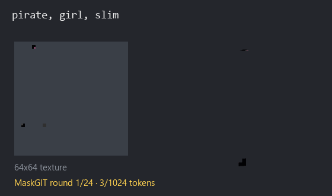
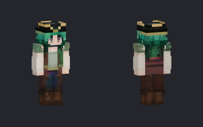
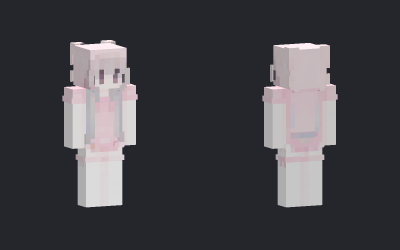
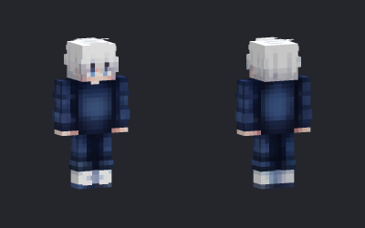
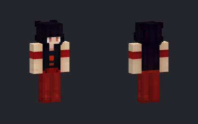
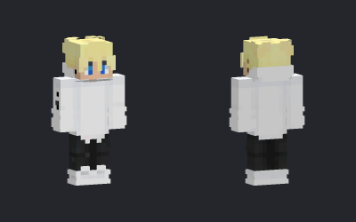
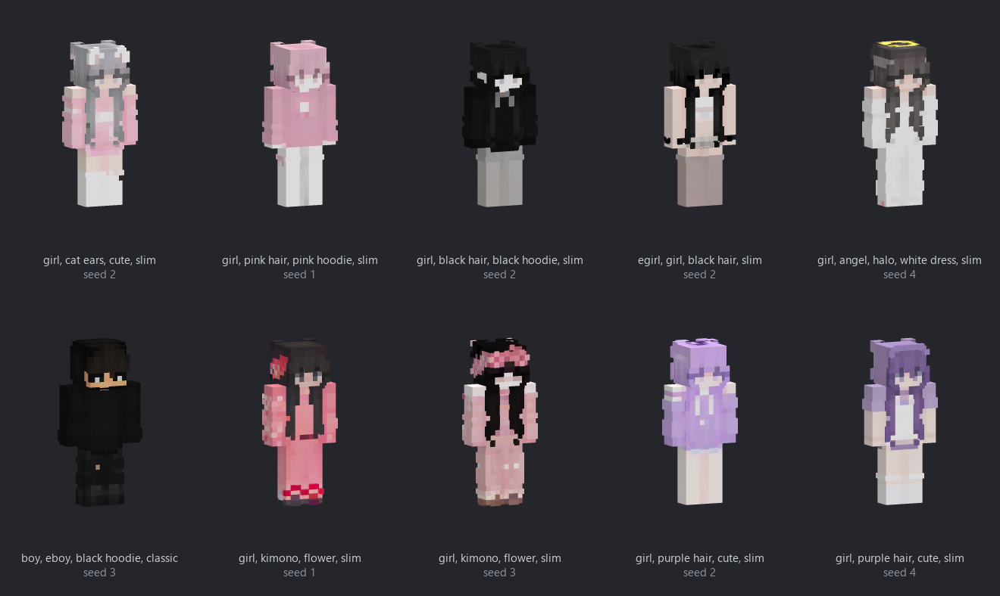
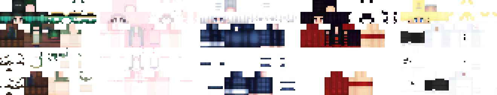
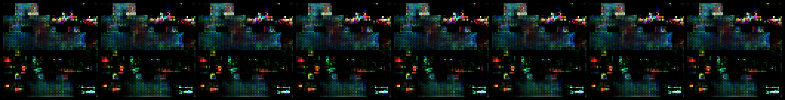
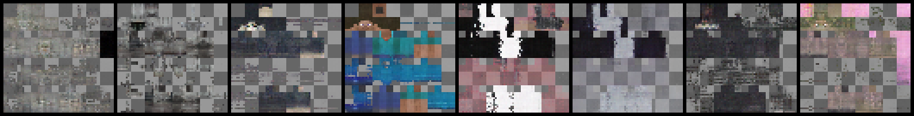

# Minecraft Skin Generator

Minecraft skins from tags, generated by a **VQ-VAE + MaskGIT** that I trained from scratch:
two small models, 19 M parameters, no Stable Diffusion, no fine-tuning.

<p align="center">
  <br>
  <sub>MaskGIT fills in the 1024 tokens of a skin over 24 rounds. Grey on the left (and gaps in
  the 3D figure) = tokens not chosen yet. Prompts and seeds: <code>pirate, girl, slim</code> · 0,
  <code>anime, boy, white hair, classic</code> · 4, <code>girl, kimono, flower, slim</code> · 3</sub>
</p>

**Highlights**
- **End to end:** data pipeline, automatic tagging, two models, training, blind evaluation, demo.
- **Every step measured:** GAN → diffusion → VQ-VAE + MaskGIT. VQ-Diffusion was tested as an
  alternative and lost a blind test: MaskGIT won 21 of 29 decided rounds, too clear to be chance.
- **Small:** trained on one RTX 3060 at home in ~4 days; generates on a laptop CPU in 10–20 s per skin.

## Examples

Generated with guidance 2.0 and 24 steps. For each prompt the best of a few seeds was picked;
the seed is given, so every image can be reproduced
([examples.json](docs/images/examples.json)). **Nothing was edited afterwards.**

<table>
<tr>
<td align="center"><br><code>pirate, girl, slim</code> · seed 0</td>
<td align="center"><br><code>cute, pastel, girl, slim</code> · seed 0</td>
</tr>
<tr>
<td align="center"><br><code>anime, boy, white hair, classic</code> · seed 4</td>
<td align="center"><br><code>girl, long hair, red dress, classic</code> · seed 3</td>
</tr>
<tr>
<td align="center" colspan="2"><br><code>boy, blond hair, white hoodie, classic</code> · seed 5</td>
</tr>
</table>

<p align="center"></p>

Raw 64×64 textures: every pixel is a hard, flat colour, straight out of the model.

<p align="center"></p>

## How it works

```
skin PNG ──VQ-VAE──▶ 32×32 tokens ──MaskGIT (+ tags)──▶ 32×32 tokens ──VQ-VAE──▶ skin PNG
```

- **VQ-VAE:** learns 512 small patches ("tokens") and turns every skin into a 32×32 grid of
  them. It can only pick existing patches, so there are no in-between colours: hard pixel-art
  edges come from the architecture, not from post-processing.
- **MaskGIT:** a transformer that fills in masked tokens. It starts with all 1024 masked and
  fills them over 24 rounds, keeping the most confident guesses each round. Tags steer it via
  classifier-free guidance.

**Why from scratch, not a fine-tuned Stable Diffusion:** skins are 64×64 pixel art with hard
edges, transparency and a fixed UV layout. Large image models are built for soft, high-resolution
pictures and add transparency only afterwards. A 19 M model fits the problem and runs on a CPU.
The trade-off: it only knows the tags it was trained on.

## What I tried

| | Approach | Result |
|---|---|---|
| 1 | GAN (DCGAN, conditional WGAN-GP) | mode collapse; the stable version was blurry with almost no variety |
| 2 | Diffusion (DDPM + guidance) | stable, but colours always slightly smeared |
| 3 | **VQ-VAE + MaskGIT** | sharp pixel art, 24 instead of 100 sampling steps → **this repo** |
| 4 | VQ-Diffusion (can correct earlier tokens) | lost the blind test: MaskGIT won 21 of 29 decided rounds (p ≈ 0.02), 2× slower |

<p align="center"><br>
<sub>GAN: every row is nearly the same skin.</sub></p>

<p align="center"><br>
<sub>Diffusion: shapes right, edges and colours soft.</sub></p>

The VQ-Diffusion comparison was a blind A/B test, rated by myself: same prompt and seed on both
sides, sides shuffled, 40 prompts, 11 of them ties.

## Data

About 94k community-made skins that people had shared publicly online. They belong to their
creators, who never agreed to their use for AI training, so **I don't publish the dataset or
the trained weights**. The code, the method and all results are public and **I'm happy to
demonstrate the model live.**

The source only had a few broad categories per skin, so every skin was rendered in 3D and tagged
by a vision-language model running locally (Qwen3.5 9B via [Ollama](https://ollama.com)). The
tagger was chosen against 50 hand-labelled skins: wrong tags went from 2.5 % to 0 %. About 2 s per
skin; after cleaning, ~600 tags. Data format: [data/README.md](data/README.md).

## Key design decisions

Each one was tested during the project.

- **÷2 downsampling** (32×32 tokens): ÷4 came out soft.
- **EMA codebook**, unused codes re-initialised; quantiser in fp32 (fp16 overflows to NaN).
- **Alpha weighted ×2** in the loss: keeps the silhouette sharp.
- **Tags added** to every token, not cross-attention (that diverged reproducibly).
- **Subset dropout:** each training sample keeps only some of its tags, which makes short prompts
  like `pirate` work.
- **Guidance 1.5–2.0:** above ~2.5 colours over-saturate.

## Run it

The trained weights are not published (see [Data](#data)). To train your own:

```bash
pip install -r requirements.txt
python -m skingen.data              # check the dataset
python train_vqvae.py               # stage 1  → runs/vqvae/
python train_maskgit.py             # stage 2  → runs/maskgit/
python generate.py "pirate, girl, slim" -n 8 --seed 7
```

Once your model is trained, try it in the browser with a 3D preview:

```bash
pip install -r demo/requirements.txt
python export_weights.py            # pack the checkpoints → weights/
python demo/app.py                  # http://127.0.0.1:7860
```

All hyperparameters are in [`skingen/config.py`](skingen/config.py), each with a comment on why;
paths go into `.env` (see [`.env.example`](.env.example)). Training resumes after an interruption.

## Files

```
train_vqvae.py        stage 1: train the VQ-VAE
train_maskgit.py      stage 2: train MaskGIT on top of it
generate.py           make skins from a prompt
export_weights.py     pack the checkpoints into a small weights/ folder
skingen/              config, data, models, sampling, weight loading
demo/app.py           web demo in the browser (Gradio, 3D preview)
docs/images/          pictures for this README
```

## License

Code: [MIT](LICENSE). Not an official Minecraft product. Not approved by or associated with
Mojang or Microsoft. Skins made with this project are AI-generated.
